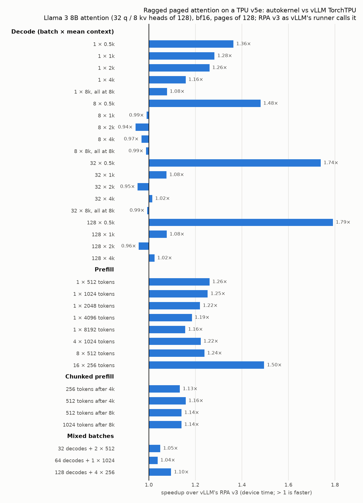

# autokernel

Write a TPU kernel as plain JAX: Python loops over tiles. Get a fast, **gridless**
[Pallas](https://docs.jax.dev/en/latest/pallas/index.html) kernel for a **TPU v5e**, with its schedule
tuned on the hardware.

```python
import jax.numpy as jnp
import autokernel


@autokernel.tunable
class MatmulTiles:  # what autokernel may choose: a frozen pytree of choices
    tm: int = autokernel.choice(128, 256, 512, 1024, 2048, default=512)
    tn: int = autokernel.choice(128, 256, 512, 1024, 2048, default=512)
    tk: int = autokernel.choice(128, 256, 512, 1024, 2048, default=512)


@autokernel.kernel
def matmul(x, y, tiles=MatmulTiles()):
    M, K = x.shape
    N = y.shape[1]
    tm, tn, tk = min(tiles.tm, M), min(tiles.tn, N), min(tiles.tk, K)
    out = jnp.zeros((M, N), x.dtype)
    for i in range(0, M, tm):
        for j in range(0, N, tn):
            acc = jnp.zeros((tm, tn), jnp.float32)
            for k in range(0, K, tk):
                acc += x[i : i + tm, k : k + tk] @ y[k : k + tk, j : j + tn]
            out = out.at[i : i + tm, j : j + tn].set(acc.astype(x.dtype))
    return out


out = matmul(x, y)                     # tunes the schedule on the first call, then runs the kernel
print(matmul.tuning(x, y))             # what tuning tried and chose
out = matmul(x, y, MatmulTiles(tm=256))  # or choose it yourself
print(matmul.source(x, y))             # the generated Pallas source: plain, standalone, readable
matmul.verify(x, y)                    # checks the kernel against the loops run as plain JAX
```

The function is plain JAX and is the specification: `matmul.fn(x, y)` runs it as written (under
`jax.jit` too: a tunable is a pytree with no leaves), and `verify` compares the kernel with it. The one
thing a kernel does differently from plain JAX is `@`, which accumulates in f32 (i32 for integers) as the
MXU does, instead of rounding `bf16 @ bf16` to bf16; `verify` uses the same rule.

autokernel targets **one chip, the TPU v5e**. Without a TPU, kernels run in the Pallas TPU interpreter
with their default schedules, so you can develop and test them anywhere.

## How it works

Every kernel is **gridless**: one `pl.loop` over all of its steps (an output tile × a reduction block),
with hand-written, multi-buffered DMAs, the way you would write a performance-critical Pallas kernel by
hand. A Pallas grid adds pipeline bookkeeping to every step; this loop decodes each step with a few scalar
ops instead.

| Python | Generated kernel |
| --- | --- |
| outer loops whose tiles the outputs are stored at | the output tiles the step loop walks |
| code before the inner loops | runs at a tile's first step |
| each inner (reduction) loop | a phase: the tile's steps for it, one phase after another |
| code after a reduction loop (the stores, after the last) | runs at the phase's last step |
| a reduction loop of one iteration | no step: its body runs inline |
| `x[i : i + T, k : k + T]` that moves every step | a ring of VMEM slots, fetched steps ahead (across phases) |
| `q[b, h, i : i + T, :]` that moves once per tile | two VMEM slots, the next tile's fetched early |
| `bias[0:1, :]` that never moves | fetched once |
| values carried between steps (`acc`) | VMEM scratch |
| `out = out.at[...].set(value)` | output slots copied to HBM asynchronously |
| `a @ b`, `a @ b.T` | MXU matmuls accumulating in f32, `b.T` read transposed in place |
| `if cond: continue` | skipped tiles and steps: no copies, no compute, no step |
| `lengths[b]`: an int32 input read element by element | an index array in SMEM |
| `if j >= lengths[b]: continue` (a mask reading an index array) | step tables made on the device before the kernel; it loops over only the steps that run |
| `w[expert[e], :, :]` | a window chosen when the kernel runs |
| a per-tile window the next tile shares (`w[expert[i // G]]`) | fetched once, not again per tile |
| `for layer in range(L):` around reduction loops (a repeat loop) | the phases' steps once per layer, the next layer's weights fetched while this one runs |
| `out = out.at[i : i + C, :].set(y)` in a reduction loop's body | a tile stored per step, its copy overlapping the next steps |
| `a = a.at[k].set(v)` on a carried value | a store into that part of its VMEM buffer |
| `new = pool` (an output allocated as an input) | the input's buffer, updated in place (`input_output_aliases`) |
| `new = new.at[slot[b], :, :].set(s)` | a store at a window chosen when the kernel runs (a scatter) |

Generated code is what runs: `kernel.source(...)` is exactly the module autokernel executes.

## Performance on a TPU v5e

Measured with JAX 0.11.2, wall-clock per call under `jax.jit`, milliseconds; reproduce with
`benchmarks/`.

**Matmul**, 8192³ bf16 (`benchmarks/matmul.py`):

| Kernel | XLA | autokernel 512³ tiles | autokernel 1024×2048×1024 tiles |
| --- | --- | --- | --- |
| dense `x @ y` | 5.905 | 6.320 | **5.739** (192 TFLOP/s) |
| causal `tril(x @ y)` | 5.912 | **3.498** | 3.607 |

The causal kernel skips every tile above the diagonal, so it does half of XLA's work.

**Causal multi-head attention** against JAX's splash attention at the same block sizes, bf16, head dim
128, q pre-scaled for both (`benchmarks/attention.py`). Outputs are identical.

| B, H, S | block_q × block_kv | splash | autokernel | speedup |
| --- | --- | --- | --- | --- |
| 4, 16, 2048 | 256 × 256 | 2.205 | **1.386** | 1.59× |
| 4, 16, 2048 | 512 × 512 | 0.945 | **0.709** | 1.33× |
| 4, 16, 2048 | 1024 × 1024 | 0.872 | **0.803** | 1.09× |
| 1, 16, 4096 | 256 × 256 | 1.876 | **1.260** | 1.49× |
| 1, 16, 4096 | 512 × 512 | 0.778 | **0.606** | 1.28× |
| 1, 16, 4096 | 1024 × 1024 | 0.695 | **0.649** | 1.07× |

## A modern transformer, kernel by kernel

Every block of today's open decoders, as autokernel kernels (each a gridless loop nest, tuned on the
chip), checked against float64 NumPy and timed against the strongest JAX baseline: XLA, JAX's Pallas
kernels (splash attention, megablox, paged and ragged-paged attention), at their best block sizes.
Fake weights and inputs, small models that fit a 16 GB v5e; bf16; ms per call, wall clock under
`jax.jit`, after tuning; reproduce with `benchmarks/<name>.py`.

| Block | Example | Baseline | autokernel |
| --- | --- | --- | --- |
| Qwen3 dense prefill (QK-norm, RoPE, GQA, SwiGLU), tokens → logits | [qwen3.py](examples/qwen3.py) | plain JAX + splash at its best blocks | **1.07–1.69×** (170–183 TFLOP/s) |
| GQA attention + output projection (+ FFN), per layer | [gqa_attention.py](examples/gqa_attention.py) | splash + XLA | **1.11–1.52×** |
| Sliding-window and gated (Qwen3-Next) attention | [gqa_attention.py](examples/gqa_attention.py) | splash (LocalMask) + XLA | **1.07–1.10×** |
| MLA prefill block (DeepSeek-V3, Kimi K2) | [mla.py](examples/mla.py) | splash with 192-wide heads + XLA | **1.38–1.57×** |
| Gated DeltaNet (Qwen3-Next), chunked | [linear_attention.py](examples/linear_attention.py) | chunked plain JAX (XLA) | **2.75–6.40×** |
| KDA (Kimi Linear), chunked | [linear_attention.py](examples/linear_attention.py) | chunked plain JAX (XLA) | **3.66–9.39×** |
| Gated DeltaNet layer (projections, conv, gates, norm) | [linear_attention_layer.py](examples/linear_attention_layer.py) | plain JAX | **1.32–1.97×** |
| MoE experts, prefill (128 / 64 experts) | [moe.py](examples/moe.py) | megablox at its best tiling, `ragged_dot` | **1.29–1.45×** |
| MoE, decode batches | [moe.py](examples/moe.py) | megablox, `ragged_dot` | parity (bandwidth bound, ~700 GB/s) |
| GQA decode attention over a KV cache (ragged lengths) | [decode.py](examples/decode.py) | paged / ragged-paged attention, XLA | **0.97–1.40×** (up to 711 GB/s) |
| Absorbed MLA decode attention | [decode.py](examples/decode.py) | XLA | **1.3–23×** (0.65× at B32 H16) |
| Decode step, dense GQA model | [decode_model.py](examples/decode_model.py) | plain JAX + the best JAX decode kernel | **1.17–1.45×** |
| A stack of FFN layers in one kernel (repeat loop) | [layer_stack.py](examples/layer_stack.py) | XLA / a kernel per layer | **1.02–1.22×** / 1.01–1.07× (744 GB/s) |
| KDA decode step (Kimi Linear), paged states updated in place | [kda_decode.py](examples/kda_decode.py) | vLLM TorchTPU's fused `decode_kda` | **1.00–1.44×**, bit-identical (up to 695 GB/s) |
| Whole decode step in one kernel (cross-layer prefetch) | [decode_megakernel.py](examples/decode_megakernel.py) | XLA / per-layer kernels | **1.03–1.45×** / 1.07× (up to 90% of HBM bandwidth) |

**Whole models**, tokens to logits (prefill) and one token per sequence per step over a KV cache
(decode), built only from autokernel kernels plus plain-JAX glue (embedding lookups, routing sorts, cache
appends), against the same models in plain JAX with the best JAX kernels for each part. Speedups over
the shapes benchmarked (prefill: batch 1-4, prompts 2048-8192; decode: batch 1-32, contexts 1k-8k):

| Model (fake weights, small configs) | Example | Prefill | Decode |
| --- | --- | --- | --- |
| Qwen3 dense (d 2048, GQA 16/8, 4 layers) | [qwen3_models.py](examples/qwen3_models.py) | **1.11–1.48×** | **1.01–1.39×** |
| Qwen3-MoE (128 experts, top-8) | [qwen3_models.py](examples/qwen3_models.py) | **1.14–1.50×** | **1.02–1.11×** |
| DeepSeek-V3-like (MLA, 128 experts, grouped routing) | [deepseek.py](examples/deepseek.py) | **1.15–1.28×** | 0.96–1.20× |
| Kimi-K2-like (MLA, 192 experts) | [deepseek.py](examples/deepseek.py) | **1.02–1.11×** | 0.97–1.21× |
| Qwen3-Next-like (3:1 Gated DeltaNet : gated attention, MoE) | [hybrid_models.py](examples/hybrid_models.py) | **1.27–1.58×** | 0.99–1.05× |
| Kimi-Linear-like (3:1 KDA : MLA, MoE) | [hybrid_models.py](examples/hybrid_models.py) | **1.55–2.00×** | 0.89–0.97× |

Where autokernel is not ahead, the time is in plain-JAX glue the kernels don't cover (MoE routing and row
gathers, the hybrid models' single-token linear-attention update) or the step is bandwidth bound already
(small decode batches read every weight once, as the baselines do, at 80–90% of the v5e's 819 GB/s).
Logits match the baselines to bf16 rounding; MoE models can differ more where a token's router scores are
near a tie and the two pick different experts.

**How these kernels are built.** Each is one loop nest (README "Writing kernels"), and the compiler
features they needed came from them:

- *Index arrays and runtime masks* (`lengths[b]`, `if j >= lengths[b]: continue`): decode attention reads
  only each sequence's cache; MoE kernels visit only the experts a tile's tokens chose; paged attention
  reads pages through `k_pages[block_table[b, p], :, :]`.
- *Repeat loops*: a stack of layers in one kernel, the next layer's weights fetched while this one runs
  (cross-layer prefetch); the whole decode step of a model is one kernel.
- *Outputs stored per step*: chunked linear attention stores each chunk's outputs from the step that
  computes them, carrying only the recurrent state.
- *Per-tile windows fetched once*: MoE tiles of one expert read its weights once.

### MoE layers at full width: autokernel vs `ragged_dot` and megablox

One MoE layer of a real model, at its real width, with random weights. bf16, ms per call under `jax.jit`.

**What's compared:**

- **autokernel:** `expert_ffn_blocks` for prefill and the streaming `moe_decode` for decode.
- **autokernel grouped matmuls:** our megablox-style `gmm_swiglu` + `gmm_down`.
- **`jax.lax.ragged_dot`:** XLA's grouped matmul.
- **megablox `gmm`:** JAX's Pallas kernel, at the best of eight tilings (64 to 1024 rows).

**Fairness:** every method is timed twice. Once at XLA's default scoped VMEM limit, and once with
`--xla_tpu_scoped_vmem_limit_kib` raised to 115 MiB. Megablox's `gmm` takes no limit of its own, and its
256-row and larger tilings only compile with the higher one. Each method is reported at its better run.
autokernel's kernels set their own limit either way.

**Columns:**

- **Experts:** the routed experts on already-dispatched rows.
- **Layer:** RMSNorm, router, dispatch, experts, combine and residual.
- **GB/s:** the fewest bytes the experts must move (each chosen expert's weights once, rows in and out)
  divided by the time.

Reproduce with `benchmarks/moe.py --config <name> --profile [--scoped-vmem-mib 115]`.

**Qwen3-235B-A22B** (d_model 4096, 128 experts, top-8, 1536 hidden units each; 4.8 GB of experts):

| Tokens | Experts: autokernel | `ragged_dot` | megablox | Layer: autokernel | `ragged_dot` | megablox | Layer speedup |
| --- | --- | --- | --- | --- | --- | --- | --- |
| 4096 (prefill) | **10.35** (119.5 TFLOP/s) | 15.00 (82.5) | 16.86 (73.4) | **14.78** | 19.92 | 21.74 | **1.35×** |
| 64 (decode) | **6.40** (750 GB/s) | 6.70 (717) | 6.88 (698) | **6.41** | 6.66 | 6.55 | 1.02× |
| 8 (decode) | **2.54** (744 GB/s) | 2.60 (727) | 2.62 (720) | **2.55** | 2.61 | 2.56 | 1.01× |

The decode rows were measured at the default limit only.

**Profiles at 4096 tokens** (default limit, from `autokernel.profile` trace regions):

| Kernel | Steps | Compute | Exposed DMA waits | Output waits | Overhead | Device time |
| --- | --- | --- | --- | --- | --- | --- |
| `expert_ffn_blocks`, 384-row tiles | 853 | 9.86 ms | 0.09 ms | 0.24 ms | 0.10 ms | 10.31 ms |
| `gmm_swiglu`, 256 × 2048 tiles | 254 | 8.57 ms | 0.40 ms | | 0.02 ms | 9.02 ms |

At 4096 tokens each expert gets ~256 rows, and the fused kernel is MXU-bound. Every weight it fetches
is hidden behind compute.

**Where megablox loses:**

- **Weight reads:** its 128-row tiles at the default limit reread an expert's weights for every 128 rows.
  At 819 GB/s that caps it near 105 TFLOP/s.
- **Straddling tiles:** a tile spanning two experts is computed once for each.
- **Unfused SwiGLU:** the gate/up output, 32k rows × 3072, goes to HBM and back through an XLA SwiGLU.

The higher VMEM limit fixes the first: 256-row tiles, 20.45 → 16.86 ms. The other two remain.

**Decode:** a few tokens touch most experts once, and every method reads those weights at 85–92% of the
v5e's 819 GB/s, so they run at parity. The streaming `moe_decode` (a repeat loop over the chosen experts,
each one's weights in blocks of hidden units, the next one fetched while this one runs) is what makes a
full-width expert fit at all: Mixtral's experts are 352 MB each.

Qwen3-Next-80B, Mixtral 8x7B and DeepSeek-V3 width (64 of its 256 experts), and 16384-token prefill, are
being measured; raw rows in `benchmarks/results/moe_full_width_v5e.jsonl`.

## A real model against vLLM: Gemma 4 E2B

[gemma4.py](examples/gemma4.py) is Gemma 4 E2B's text decoder with its real weights:

- **Model:** 35 layers, sliding-window and full attention with one KV head (head dim 256 / 512), KV
  caches shared by the last 20 layers, double-wide MLPs, per-layer embeddings, soft-capped tied LM head.
- **Generation:** greedy, prefill then every decode step in one jitted loop.
- **Kernels:** built from [gemma4_kernels.py](examples/gemma4_kernels.py). A batch of one decodes with
  [gemma4_megakernel.py](examples/gemma4_megakernel.py), which runs all 35 layers and the LM head as
  one kernel.
- **Correctness:** its greedy tokens agree with a plain-JAX reference at every position checked.

The baseline is vLLM 0.31 (`vllm-tpu`, its JAX backend) on the same v5e and the same workload:

- 128-token random prompts, all submitted at once;
- 256 greedy tokens each, EOS ignored;
- output tokens/s, wall time with prefill included.

Reproduce with `benchmarks/vllm_gemma4.py` and `benchmarks/gemma4.py`.

| Batch | vLLM tok/s | autokernel tok/s | | decode ms/step |
| --- | --- | --- | --- | --- |
| 1 | 147.9 | **158.2** | 1.07× | 6.31 |
| 8 | 1,133.5 | **1,202.2** | 1.06× | 6.58 |
| 32 | 3,816.1 | **4,113.1** | 1.08× | 7.43 |
| 64 | 6,158.7 | **6,853.0** | 1.11× | 8.63 |
| 128 | 9,088.2 | **10,294.4** | 1.13× | 11.00 |
| 256 | 11,713.1 | **13,603.8** | 1.16× | 15.93 |

**Small batches.** A decode step reads 4.5 GB of weights, about 5.5 ms at 819 GB/s. Batch 1 runs at
6.3 ms, and its profile is copy-bound.

**The one-kernel step.** It wins only at batch 1: 6.31 ms against 6.36 ms for the per-layer kernels. Its
attention takes a step per sequence, so from batch 8 up the per-layer kernels are faster: 6.58 against
6.70 ms at B8, 7.44 against 8.09 at B32.

**Tuning** changed these by under 1% at every batch, so the table is at the default tiles.

## KDA decode against vLLM TorchTPU's kernel

[kda_decode.py](examples/kda_decode.py) is Kimi Linear's KDA (Kimi Delta Attention) decode step as one
loop nest: one token per sequence, the recurrent and short-convolution states in paged pools updated in
place. It computes the same function as vLLM TorchTPU's fused `decode_kda` kernel (vllm-torchtpu v0.29.0,
vendored unmodified in [benchmarks/vs_vllm_kda](benchmarks/vs_vllm_kda)), with the same inputs and outputs:

- the state pools gathered by `state_indices`, with slot 0 a null block (zeros out, the slot untouched);
- `has_initial_state` (a sequence's first step starts from zero states);
- the 4-tap conv + SiLU, L2-normalized q and k, the per-channel decay, and the delta rule;
- vLLM's options: transposed (d_v, d_k) state pools and the gate's lower bound.

**Correctness.** The arithmetic is vLLM's, in its order, and the outputs, conv states and states are
**bit for bit the same** on a v5e, for every batch, both layouts and both tile sizes
(`test_kda_decode.py`, `benchmarks/vs_vllm_kda/run.py`). Against float64 NumPy, both kernels' states differ by
~4e-5 (the median head; the MXU rounds f32 operands to bf16, as XLA's default does).

**Workload.** Kimi Linear 48B's KDA layers (32 heads of 128, a 4-tap conv; bf16 activations, f32 state):

- a pool of 2 × batch + 1 slots, each sequence in a random real slot;
- a tenth of the sequences on their first step;
- both pools donated, as a decode loop runs the step.

**Measurement.**

- Device time: the time per call the profiler shows ops on the TPU (the kernel and the ABI's small
  reshapes, which both pay).
- Wall time: the median over 5 repeats of the mean of 20 back-to-back calls (batch 1-8 are host-bound).
- GB/s: the bytes a step must move (each sequence's state and conv slots read and written, its inputs and
  output) over the device time. A v5e has 819 GB/s.

Device µs per step, the [raw log](benchmarks/results/kda_decode_vs_vllm_v5e.txt); reproduce with
`benchmarks/vs_vllm_kda/run.py [--transposed]`:

| Batch | vLLM | autokernel | speedup | GB/s vLLM / autokernel | wall µs vLLM / autokernel | plain JAX (XLA) |
| --- | --- | --- | --- | --- | --- | --- |
| 1 | 10.7 | **8.5** | 1.26× | 420 / 528 | 48.7 / 48.5 | 18.0 |
| 8 | 55.0 | 55.2 | 1.00× | 640 / 638 | 66.7 / 66.4 | 189.0 |
| 32 | 215.5 | **206.5** | 1.04× | 651 / 680 | 231.7 / 221.5 | 717.0 |
| 64 | 429.3 | **408.4** | 1.05× | 654 / 687 | 447.5 / 424.3 | 2232.6 |
| 128 | 856.2 | **811.6** | 1.05× | 655 / 691 | 876.2 / 830.3 | 4462.7 |
| 256 | 1706.4 | **1615.3** | 1.06× | 658 / 695 | 1729.4 / 1635.8 | 8915.7 |

With vLLM's own (d_v, d_k) state layout (`--transposed`):

| Batch | vLLM | autokernel | speedup | GB/s vLLM / autokernel |
| --- | --- | --- | --- | --- |
| 1 | 12.4 | **8.6** | 1.44× | 363 / 520 |
| 8 | 58.6 | **54.8** | 1.07× | 601 / 642 |
| 32 | 218.7 | **205.8** | 1.06× | 642 / 682 |
| 64 | 432.7 | **408.5** | 1.06× | 649 / 687 |
| 128 | 858.9 | **810.9** | 1.06× | 653 / 692 |
| 256 | 1711.2 | **1617.8** | 1.06× | 656 / 694 |

**What limits each.** Per sequence the step moves 4 MiB of f32 state (read and written), and computes for
~2 µs, under the copies. So both kernels are bound by HBM:

- **vLLM's grid pipeline** reads the next sequence's slots while it writes the last one's. Interleaved
  reads and writes are what a v5e's HBM is slowest at: a pure VMEM round trip of 1 MiB copies moves
  640-650 GB/s however it is pipelined. vLLM's kernel runs at 80% of 819 GB/s.
- **autokernel's kernel** moves its copies in bursts of 8 sequences, picked by the tuner from the profile
  (`Pipeline.bursts`, above): the next burst's slots are read while this burst computes, then this burst's
  are written. It runs at 84-85%; alternating 8-16 MiB bursts of a pure round trip reach 677-683 GB/s.
- **Batch 1** has nothing to pipeline across. The tuned 16-head tiles overlap one half's copies with the
  other's compute.
- **Batch 8** is too short for bursts to pay for their fill and drain: parity.
- **Transposed pools.** vLLM's kernel swaps every state into (d_k, d_v) and back, which doubles its compute.
  autokernel reads the transposed states as transposed MXU weights instead: the same products, summed in
  the same order.

The plain-JAX step (gather, conv, `delta_step`, scatter: hybrid_models.py's Kimi-Linear decode path) runs at
15-31% of the bandwidth, 2-5× slower, and its states differ from float64 by ~3e-3 on a v5e.

**What autokernel needed:**

- *Outputs updated in place* (`new_state = state`: input_output_aliases);
- *stores at windows an index array chooses* (`new_state.at[state_indices[b], h : h + TH, :, :]`);
- *copies in bursts*, a pipeline choice for single-step kernels;
- kernels updating inputs in place are now also timed in place when tuning (donated): undonated, XLA copies
  the pool first, and 16-head tiles ran up to 5% faster on the fresh copy than they do in place.

## Ragged paged attention against vLLM TorchTPU's RPA v3

[ragged_paged_attention.py](examples/ragged_paged_attention.py) is vLLM's attention over a paged KV cache for a
whole batch of sequences at once, with decodes, prefills and prefill chunks mixed. It has the same inputs and
outputs as vLLM TorchTPU's `ragged_paged_attention` (RPA v3, vllm-torchtpu v0.29.0, vendored unmodified in
[benchmarks/vs_vllm_rpa](benchmarks/vs_vllm_rpa)):

- q (T, H, D), k and v (T, Hkv, D): every sequence's new tokens, concatenated;
- a cache of pages (pages, page_size, Hkv, 2, D), each head's key and value side by side;
- kv_lens, page_indices, cu_q_lens and distribution;
- the step writes the new tokens' keys and values into the cache, in place, and attends causally.

It is three loop nests, each a plain-JAX function of tiles:

- `rpa_write`: the new keys and values into their pages, a tile per run of a sequence's tokens in one page;
- `rpa_decode`: a tile per decoding sequence, a step per page of its cache;
- `rpa_prefill`: a tile per 256 queries of a sequence, a step per 4 pages up to its last query.

**Correctness.** The updated caches are exact for both kernels. Against float64 NumPy, autokernel's outputs
are 1.7-8.6x closer than RPA's on every workload checked (e.g. decode 128 × 1k: 0.0010 vs 0.0046; prefill
4 × 1024: 0.0097 vs 0.021). autokernel accumulates in f32; RPA accumulates in bf16.

**Which vLLM.** vLLM TorchTPU's runner passes `distribution = [decodes, decodes, sequences]` and no
`chunk_prefill_size` (tpu-inference: `runner/persistent_batch_manager.py`, `runner/tpu_runner.py`). So in
serving, every sequence with more than one new token runs RPA's MIXED kernel: that is `vllm` below. RPA's
PREFILL case (a static query length) is measured too, as `vllm-prefill`, wherever every prefill has the same
length. It is ~11 µs slower than MIXED on every workload, because it launches the PREFILL kernel and then
an empty MIXED one.

**Workload and measurement.**

- Model: Llama 3 8B's attention: 32 query heads, 8 kv heads of 128, bf16, pages of 128 positions,
  sequences of up to 8192.
- Decode cache lengths: ragged, half to 1.5x the mean; "8k" means every sequence is at 8192.
- Each method is jitted with the cache donated and fed back, and with fresh q, k and v donated, as a model
  step runs it. autokernel is tuned on each workload first.
- Device time: the ops the profiler shows on the TPU per step: the kernels and all their XLA glue.

Device µs per step on a TPU v5e. The [raw log](benchmarks/results/rpa_vs_vllm_v5e.txt) has each method's
largest ops and the float64 checks. Reproduce with `benchmarks/vs_vllm_rpa/run.py [--check]`, and plot with
`uv run --with matplotlib python benchmarks/vs_vllm_rpa/plot.py`:



Decode, one new token per sequence (batch × mean context):

| Batch | 512 | 1k | 2k | 4k | all at 8k |
| --- | --- | --- | --- | --- | --- |
| 1 | 15.0 → **11.0** (1.36×) | 17.7 → **13.8** (1.28×) | 17.4 → **13.8** (1.26×) | 25.6 → **22.1** (1.16×) | 55.2 → **51.2** (1.08×) |
| 8 | 55.8 → **37.7** (1.48×) | 64.1 → 64.7 (0.99×) | 98.6 → 104.6 (0.94×) | 167.7 → 173.2 (0.97×) | 365.6 → 369.9 (0.99×) |
| 32 | 203.3 → **116.9** (1.74×) | 217.6 → **202.2** (1.08×) | 362.4 → 380.6 (0.95×) | 811.8 → **799.7** (1.02×) | 1431.2 → 1441.1 (0.99×) |
| 128 | 799.7 → **446.4** (1.79×) | 860.8 → **799.0** (1.08×) | 1513.4 → 1581.2 (0.96×) | 3121.7 → **3047.4** (1.02×) | |

(vLLM → autokernel. Batch 128 at 8k would be an 8.6 GB cache, with its copy.)

Prefill, chunked prefill and mixed batches:

| Workload | vLLM (MIXED) | vLLM (PREFILL) | autokernel | speedup |
| --- | --- | --- | --- | --- |
| 1 prompt of 512 | 93.7 | 104.8 | **74.3** | 1.26× |
| 1 prompt of 1024 | 208.8 | 220.2 | **166.6** | 1.25× |
| 1 prompt of 2048 | 533.5 | 544.5 | **437.2** | 1.22× |
| 1 prompt of 4096 | 1580.5 | 1591.3 | **1333.5** | 1.19× |
| 1 prompt of 8192 | 5265.8 | 5276.9 | **4551.5** | 1.16× |
| 4 prompts of 1024 | 784.9 | 795.9 | **641.8** | 1.22× |
| 8 prompts of 512 | 650.6 | 661.4 | **525.1** | 1.24× |
| 16 prompts of 256 | 649.8 | 660.6 | **434.4** | 1.50× |
| 256 tokens after 4k | 168.6 | 169.6 | **148.7** | 1.13× |
| 512 tokens after 4k | 328.5 | 339.8 | **283.5** | 1.16× |
| 512 tokens after 8k | 593.8 | 605.1 | **520.6** | 1.14× |
| 1024 tokens after 8k | 1137.3 | 1148.6 | **997.2** | 1.14× |
| 32 decodes + 2 chunks of 512 | 806.7 | 817.4 | **768.5** | 1.05× |
| 64 decodes + 1 chunk of 1024 | 1307.4 | 1318.6 | **1259.8** | 1.04× |
| 128 decodes + 4 chunks of 256 | 1231.6 | 1242.2 | **1123.6** | 1.10× |

(The speedup is over vLLM's faster case, MIXED.)

**Where the time goes.**

- **Short-context decode** (1.3-1.8×): RPA's decode kernel spends a fixed cost per sequence. autokernel's
  finds each sequence's pages as it runs (a cursor over runtime loop bounds), with no step tables.
- **Long-context decode** (0.94-1.02×): both read the cache at 710-750 GB/s of the v5e's 819. autokernel loses
  4-6% at a mean of 2k contexts: its write kernel takes a step per sequence, which RPA fuses into its
  attention kernel.
- **Prefill**: most of autokernel's lead is glue. RPA's `prepare_inputs` and `prepare_outputs` reshuffle q's
  heads and the output's on the way in and out. That is ~270 µs of XLA copies at 4096 tokens, which vLLM pays
  in serving too. The kernels alone are closer, and RPA's prefill kernel is faster on short prompts:

| Kernel only, µs | 1 × 512 | 1 × 2048 | 1 × 4096 | 1 × 8192 | 4 × 1024 | 16 × 256 | 512 after 8k |
| --- | --- | --- | --- | --- | --- | --- | --- |
| RPA (attention + KV write) | **48.3** | **372.2** | **1264.8** | 4641.4 | **469.3** | **334.5** | 548.3 |
| autokernel `rpa_prefill` + `rpa_write` | 69.8 | 432.6 | 1329.6 | **4547.7** | 618.5 | 418.6 | **516.1** |

Its compute is the softmax over (8 heads, 1024 query rows, 512 keys) per step. Probes of the tile code
(`probe_prefill_variants.py`) found the mask and the score scaling free. Masking only the diagonal steps
(`lax.cond`) and going head by head were 1.5-2× slower.

**What autokernel needed:**

- *runtime loop bounds* (`for p in range((kv_lens[s] + ps - 1) // ps)`), stepped by a cursor as the kernel
  runs;
- *a runtime count of tiles* (`for k in range(n_tiles[0])`);
- *ragged row windows* (`q[autokernel.rows(start, stop, 256), :, :]`): copies of as many rows as are valid;
- *windows gathered through index-array slices* (several pages per step);
- *a 16-bit tile's pairs of rows as 32-bit words* (`autokernel.pairs`, `autokernel.unpairs`): RPA's cache
  holds each key and value in one word, split with shifts.

## Writing kernels

```python
@autokernel.kernel
def f(x, y, tiles=Tiles()):                   # the input arrays; optionally last, a tunable
    M, K = x.shape                            # prologue: Python on shapes, run when the kernel is built
    TM, TN, TK = tiles.tm, tiles.tn, tiles.tk # (the tunable's fields are plain Python values)
    out = jnp.zeros((M, N), jnp.float32)      # each output allocated once: jnp.zeros or jnp.full
    for i in range(0, M, TM):                 # parallel loops: each iteration stores its own tiles
        for j in range(0, N, TN):
            if j > i:                         # optional tile mask: skip this output tile
                continue
            acc = jnp.zeros((TM, TN))         # code before the reduction loops: once per tile
            for k in range(0, K, TK):         # any number of reduction loops, one after another
                if k > i:                     # optional step mask: skip this step
                    continue
                acc += x[i : i + TM, k : k + TK] @ y[k : k + TK, j : j + TN]
            out = out.at[i : i + TM, j : j + TN].set(acc)   # each output stored once per tile, at the end
    return out
```

- **Parameters** are the input arrays, then optionally a tunable with a default instance of an
  `@autokernel.tunable` class; tile code reads its fields (`tiles.tm`).
- **Loops** are `range(start, stop, step)` with ints known when the kernel is built (constants, closures,
  shapes, the tunable's fields), a whole number of steps, starting at a multiple of the step.
- **Inputs are read as tiles.** Each index is `v : v + size` or `v` for a loop variable `v`, `:`, a constant
  slice (`8:16`) or a constant int. Integer indices come before sliced dims (`q[b, h, i : i + T, :]`).
  Tiles follow the TPU layout: the last dim a multiple of 128, the second-to-last a multiple of 8 (16 for
  bf16, 32 for 8-bit), each unless it is the whole dim.
- **Outputs stored per step**: a reduction loop's body (outside repeat loops) may store an output, a tile
  per step, placed by the parallel loops and the reduction loop's variable (`out = out.at[i : i + C, :].set(y)`
  in a scan over chunks `i`, with the state carried): each step's tile goes to HBM while the next steps run.
  No mask may skip tiles or steps of such a kernel.
- **Outputs are stored as tiles**: every parallel loop places each output tile through exactly one dim
  (`v : v + step`, or `v` for a loop of step 1), covering the dim exactly; other dims are stored whole
  (`:`). Masked-out tiles keep the allocation's value (`jnp.zeros`, `jnp.full(..., -jnp.inf)`), written by
  DMAs that overlap the compute.
- **Outputs updated in place**: an output allocated as an input (`new_state = state`) is that input's
  buffer (donate it under `jax.jit` and nothing is copied): what no tile stores keeps the input's values.
  Only such an output may be stored at a window an index array chooses, `new_state.at[slots[b], h : h + T,
  :, :].set(s)` (a paged cache or state pool), the parallel loop reading the index array placing it. Tiles
  must not read windows other tiles store: which one a read sees isn't defined (nor which of two stores to
  one window lands, as in JAX's scatter).
- **Tile code** is assignments, augmented assignments and `with jax.named_scope(name):` blocks; use
  `jnp.where` instead of `if`. Values carried from one reduction step to the next (`acc`) are found
  automatically and kept in VMEM, so each keeps one type, the one the loop body gives it: start it with
  that type (`jnp.zeros((TM, TN), jnp.float32)` for `acc += a @ b`, which is f32), or with a number
  (`m = -1e30`). Nothing carries over from one tile to the next. Every tile that runs takes at least one
  step of each reduction loop.
- **Reduction loops** run one after another, each a phase of the tile's steps: a whole transformer block
  (attention over key blocks, then a feed-forward layer over blocks of hidden units) is one kernel. Code
  between them runs once, at the end of the phase before; values it hands to the next phase are carried in
  VMEM like accumulators. A loop of one iteration (`range(0, F, F)`) takes no step: its body runs inline,
  and windows only it moved are fetched once, so a tunable block size covering a whole dim turns streamed
  weights into resident ones.
- **Repeat loops**: a loop around reduction loops (`for l in range(L):` holding a layer's reduction loops
  and code) runs their steps iteration after iteration, carrying values from one iteration to the next as
  from one step to the next. Windows it moves (`w_up[l, :, f : f + bf]`) stream with the phase that reads
  them, so the pipeline fetches the next iteration's (the next layer's weights) while this one runs: a
  whole stack of layers is one kernel, with prefetch across layers. The repeat loop's own code runs at its
  first phase's first step and its last phase's last step, every iteration; the tile's code after the loop,
  as its last iteration ends. Repeat loops don't nest; one of one iteration runs inline.
- **Loop variables** can be used as values (`i + jax.lax.broadcasted_iota(...)`); they behave as Python
  ints (`bf16_tile * i` stays bf16), as int32 in the kernel.
- **Defaults that don't fit** (block sizes too big for VMEM, or not dividing the arrays) are replaced by the
  nearest tunable that builds, and schedules Mosaic can't compile are ruled out while tuning.
- **Masks** are `if cond: continue` at the top of a loop. They are Python conditions on loop variables and
  constants, evaluated once per combination of the loop values they read when the kernel is built; the
  kernel walks SMEM tables of only the tiles and steps that run. Tables cover only the loops a mask reads:
  causal attention's masks don't read the batch and head loops, so its tables hold one batch-head pattern.
  A tile whose mask skips every block of a reduction loop takes one empty step of it (no copies, no body).
- **Index arrays** are int32 inputs read element by element, `lengths[b]` (integer indices only, loop
  variables and constants): the kernel keeps them in SMEM. Their elements are values in tile code
  (`cols < lengths[b]`), integer indices of tile reads (`w[expert[t], :, j : j + tn]`: the window is
  chosen when the kernel runs, clamped to the array as JAX clamps), and conditions in reduction masks
  (`if j >= lengths[b]: continue`). Such **runtime masks** are evaluated on the device just before the
  kernel, for every step at once (Python's `and`, `or`, `not` become their elementwise forms), and the
  kernel loops over only the steps that run: a KV-cache read stops at each sequence's length, a grouped
  matmul visits only the experts whose tokens meet a tile. The function itself branches on array values
  there, so it runs as plain JAX eagerly (not under `jax.jit`); the kernel runs anywhere.
- **Constants** the tile code reads (module globals, closure values, prologue names) are read when a kernel
  is first built for an input shape, as `jax.jit` does, and written into the generated source: numbers,
  strings, dtypes, tuples, modules, and functions (imported, or their source copied).

Anything else is rejected with a `KernelError` naming the line, before anything runs.

The [examples](examples/) start with matmul, causal matmul, causal multi-head (splash) attention, RMSNorm
fused with the projection after it, and a whole attention block (attention, RMSNorm, feed-forward layer)
in one kernel; then every block of a modern decoder and whole models built from them (above, "A modern
transformer"), each tested against NumPy and the JAX baselines.

**A whole attention block in one kernel** ([examples/attention_block.py](examples/attention_block.py)):
causal multi-head attention, the post-attention RMSNorm and the feed-forward layer
(`gelu(h @ w_up) @ w_down`). The parallel loops walk (batch, query block); the tile's first reduction loop
is flash attention over the key blocks for every head at once (skipping future blocks); the code after it
puts the heads side by side and normalizes them; the second reduction loop is the feed-forward layer over
blocks of hidden units, streaming the weights (or keeping them in VMEM, if the tuner picks a block of all
of them). Nothing between attention and the block's output goes to HBM. Against JAX's splash attention
followed by RMSNorm and the feed-forward layer in XLA, tuned, on a v5e (bf16, ms; `benchmarks/attention_block.py`):

| B | H | S | head dim | F | splash (default blocks) + norm + FFN | splash (its best blocks) + norm + FFN | autokernel | vs default | vs best |
| --- | --- | --- | --- | --- | --- | --- | --- | --- | --- |
| 4 | 8 | 2048 | 128 | 4096 | 4.226 | 1.245 | **1.106** | 3.82× | 1.13× |
| 8 | 8 | 1024 | 128 | 4096 | 2.603 | 1.099 | **1.022** | 2.55× | 1.08× |
| 2 | 16 | 2048 | 128 | 8192 | 4.933 | 1.951 | **1.821** | 2.71× | 1.07× |
| 1 | 16 | 4096 | 128 | 8192 | 7.330 | 2.199 | **2.066** | 3.55× | 1.06× |
| 4 | 16 | 2048 | 64 | 4096 | 6.784 | 1.837 | **1.714** | 3.96× | 1.07× |
| 1 | 32 | 2048 | 128 | 16384 | 6.118 | 3.539 | **3.264** | 1.87× | 1.08× |

**A whole transformer** ([examples/transformer.py](examples/transformer.py)): a decoder-only model,
tokens to logits (embedding, L pre-norm layers of causal multi-head attention and a GELU feed-forward
layer, final norm, vocab projection), as autokernel kernels composed in plain JAX on (batch, seq, d_model)
activations, a head being a block of columns (no transposes). Per layer: the attention RMSNorm fused with
the QKV projection; then attention, output projection, residual, RMSNorm, feed-forward layer and residual
in one kernel of three phases. With big feed-forward weights the attention's query blocks are too few rows
to reuse them, so the feed-forward layer can run as a kernel of its own instead: each layer runs the form
its kernels' tuned device times say is faster. The QKV projection stays a kernel of its own: attention for
a query block needs every earlier token's keys and values. Against the same model in plain JAX with
splash attention, tuned, on a v5e (bf16, ms; `benchmarks/transformer.py`):

| layers | d_model | heads | FFN | batch | seq | splash default | splash best | autokernel | vs default | vs best | layer |
| --- | --- | --- | --- | --- | --- | --- | --- | --- | --- | --- | --- |
| 4 | 1024 | 8 | 4096 | 4 | 2048 | 24.200 | 11.380 | **9.225** | 2.62× | 1.23× | fused |
| 4 | 2048 | 16 | 8192 | 2 | 2048 | 24.048 | 14.902 | **13.902** | 1.73× | 1.07× | split |
| 2 | 2048 | 16 | 8192 | 1 | 4096 | 16.792 | 9.617 | **8.930** | 1.88× | 1.08× | fused |
| 2 | 4096 | 32 | 16384 | 1 | 2048 | 16.553 | 13.092 | **12.721** | 1.30× | 1.03× | split |

(Logits agree with the baseline to 0.03–0.05, one or two bf16 steps. Timings vary by 1–2% from run to
run, tuning included.)

**RMSNorm fused with a projection** ([examples/rmsnorm_matmul.py](examples/rmsnorm_matmul.py)): the row
scale commutes with the matmul, `rmsnorm(x) @ w = (1 / rms(x)) * ((x * gamma) @ w)`, so one reduction
over the model dimension accumulates `(x * gamma) @ w` on the MXU and each row's sum of squares, and the
tile is scaled once at the end. The normalized activations never go to HBM; tuned, it is 1.08–1.16×
faster than XLA's `rmsnorm(x) @ w` on large inputs, and even with it on 512 rows.

## Tuning: test, trace, change the schedule

A kernel's schedule is its tunable (the `@autokernel.tunable` default of its last parameter: block sizes,
or anything the loops read from it) and its buffering (VMEM slots per copy). Call a kernel without its
tunable and, the first time it sees inputs of a shape, autokernel tunes the schedule on the TPU, on random
inputs of that shape, from first principles:

1. **Test** each candidate: its output must match the loops run as plain JAX, or it's out (as is one that
   doesn't build, doesn't fit in VMEM, or Mosaic can't compile).
2. **Trace** it: run it under the JAX profiler. Its device time ranks it, and its trace regions say what
   limits it (below).
3. **Change the schedule** the way the bottleneck says, keeping what's faster: exposed input copies → more
   input buffers (and, for a kernel whose tiles take one step, copies in bursts: below), then the
   neighbouring tiles that move fewer bytes; exposed output copies → more output buffers; per-step
   overhead → the neighbouring tiles with fewer, bigger steps; compute-bound → every neighbour, fewest
   steps first. A neighbour moves one field one step along its choices.

It climbs from the defaults until nothing proposed is faster (at most 12 candidates), and remembers the
result for inputs of that shape. A kernel that updates inputs in place is timed in place (its inputs
donated, each call's outputs the next one's inputs), as a decode loop runs it.

**Copies in bursts.** A v5e's HBM loses time turning around between reads and writes: streaming a pool
through VMEM and back in 1 MiB copies moved 640-650 GB/s however deep the pipeline (reads alone: 731 GB/s,
writes alone: 639), and XLA's own elementwise pass 673. A kernel whose tiles take one step can move its
copies in bursts instead (`Pipeline.bursts(g)`): the next g steps' inputs are fetched while this burst
computes, and the burst's outputs go out once they are in, so the copies in flight all read or all write.
In bursts of 8-16 MiB the same stream moved 677-683 GB/s. The tuner tries bursts when such a kernel is
copy-bound. Passing a tunable skips tuning; off a TPU the defaults are used. Tuning
also works when the first call is traced (`jax.jit(matmul)(x, y)`): it runs on a thread of its own.

On a v5e (bf16; device time of the chosen schedule; `benchmarks/`):

| Kernel | defaults | tuned | chosen |
| --- | --- | --- | --- |
| matmul 4096³ from 128³ tiles (`tests/test_tpu.py`) | 7.72 ms | **0.736 ms** (187 TFLOP/s) | 1024³, 4 input buffers |
| matmul 8192³ | 6.35 ms | **5.77 ms** (XLA: 5.90) | 2048 × 1024 × 512 |
| causal matmul 8192³ | 3.48 ms | **3.24 ms** (XLA: 5.91) | 512 × 512 × 1024 |
| attention 4 × 16 × 2048 | 0.700 ms | **0.685 ms** (splash at its best: 0.872) | 512 × 512, 4 input buffers |
| RMSNorm + projection 8192 × 4096 → 4096 | 1.66 ms | **1.49 ms** (XLA unfused: 1.61) | 2048 × 1024 × 512 |
| RMSNorm + projection 16384 × 2048 → 2048 | 0.876 ms | **0.778 ms** (XLA unfused: 0.907) | 2048 × 1024 × 512 |
| RMSNorm + projection 512 × 4096 → 4096 | 0.114 ms | **0.110 ms** (XLA unfused: 0.109) | 512 × 1024 × 512 |

The 128³ run, as `kernel.tuning(x, y)` prints it: the defaults were DMA-bound, so the first move was a
fourth input buffer; then each step of tiles (compute-bound, but with tiny steps) cut the time, until
1024³ tiles, where nothing proposed was faster:

```
chose Small(tm=1024, tn=1024, tk=1024), 4 input / 2 output buffers
   Small(tm=128, tn=128, tk=128), 3 input / 2 output buffers        7722.6 us  dma
   Small(tm=128, tn=128, tk=128), 4 input / 2 output buffers        6021.9 us  compute
   Small(tm=256, tn=128, tk=128), 4 input / 2 output buffers        3428.2 us  compute
   ...
 * Small(tm=1024, tn=1024, tk=1024), 4 input / 2 output buffers      736.1 us  compute
```

### Trace regions

```python
report = autokernel.profile(matmul, x, y, MatmulTiles(tm=256, tn=256, tk=256))  # on a TPU v5e
print(report)
```

```
matmul (MatmulTiles(tm=256, tn=256, tk=256), 3 input / 2 output buffers): 13541.7 us per call over 5 calls
  steps               32768     (0.41 us each)
  compute            9356.9 us
  input waits        2912.4 us  (+0.8 us filling the pipeline)
  output waits         35.9 us
  other              1235.7 us  (decoding steps, starting copies, draining)
  bottleneck: dma
```

(An 8192³ bf16 matmul with 256³ tiles: 22% of its time is copies the pipeline didn't hide.)

To profile, the kernel is generated with **trace regions**: in every step its input waits
(`<kernel>/wait`), its output-slot waits (`<kernel>/out_wait`) and the tile code (`<kernel>/compute`) are
`jax.named_scope`s, which Pallas lowers to Mosaic trace regions and libtpu records with
`--xla_enable_custom_call_region_trace=true`. Importing autokernel sets that flag (if JAX's backend hasn't
started yet; else call `autokernel.enable_profiling()` first thing). Scopes you open in tile code,
`with jax.named_scope("softmax"):`, are reported too. The trace stays in `report.logdir` for TensorBoard
or XProf.

## API

| | |
| --- | --- |
| `@autokernel.tunable`, `autokernel.choice(...)` | declare what a kernel's schedule may be |
| `@autokernel.kernel` | compile a loop nest; the result is called like the function, with or without its tunable |
| `kernel.tuning(*inputs)` | the `Tuning` for inputs like these: every trial, and the `config` chosen |
| `kernel.lower(*args)` | the `Lowered` kernel for inputs like these (arrays or `jax.ShapeDtypeStruct`s) and tunable: `source`, `plan`, `schedule`, `config`, `steps`, `tiles`, `vmem_bytes` |
| `kernel.source(*args)` | the generated Pallas source |
| `kernel.reference(*args)` | the loop nest run as plain JAX |
| `kernel.verify(*args, rtol=None, atol=None)` | run both and compare; the largest difference |
| `autokernel.profile(kernel, *args)` | a `KernelProfile` from the device trace |
| `autokernel.enable_profiling()` | have libtpu record trace regions (if autokernel was imported after JAX started) |

## Development

```bash
uv sync                                  # CPU: kernels run in the Pallas TPU interpreter
uv run pytest --cov=autokernel           # 100% line and branch coverage is required
uv run ruff check . && uv run ruff format --check .
uv run python examples/causal_attention.py
uv run python benchmarks/attention.py    # on a TPU v5e
```

On CPU the tests run every kernel in the TPU interpreter with its race detector, and cross-lower every
kind of kernel to Mosaic for a v5e, which catches what the interpreter can't. `tests/test_tpu.py` runs on a
v5e only: kernels natively, against splash attention, real profiles, and tuning. [AGENTS.md](AGENTS.md) describes
the architecture, the conventions, and how to run on a TPU.

```
src/autokernel/
  parse.py      the loop-nest language: Python source -> Nest (syntax only)
  plan.py       a Nest for concrete shapes: loops, tiles, operands, carried values, types
  schedule.py   step order; masks evaluated into SMEM step and tile tables
  tunable.py    @autokernel.tunable: the pytree of choices a kernel gives autokernel
  tune.py       the autotuner: test, trace, change the schedule
  pipeline.py   buffering (slots per copy) and VMEM accounting
  codegen.py    the gridless Pallas source
  mxu.py        what `@` means, for kernels and references alike
  reference.py  the function as plain JAX
  api.py        @autokernel.kernel, Kernel, Lowered, verify
  profiling.py  trace regions -> KernelProfile
  tilecode.py   names tile code reads and assigns; output stores
  v5e.py        the chip: memories and layout rules
  errors.py     KernelError
examples/       matmul, causal matmul, causal attention (+ JAX splash), RMSNorm fused with a projection,
                a whole attention block, a whole transformer; Qwen3 (GQA, QK-norm, RoPE, sliding window,
                gated attention, SwiGLU), MLA, MoE, KV-cache decoding (paged too), linear attention
                (Gated DeltaNet, KDA), whole Qwen3 / Qwen3-MoE / DeepSeek-V3 / Kimi-K2 / Qwen3-Next /
                Kimi-Linear-like models, a decode step in one kernel; Gemma 4 E2B with its real weights
benchmarks/     timing and profiling scripts for a TPU v5e
tests/
```
